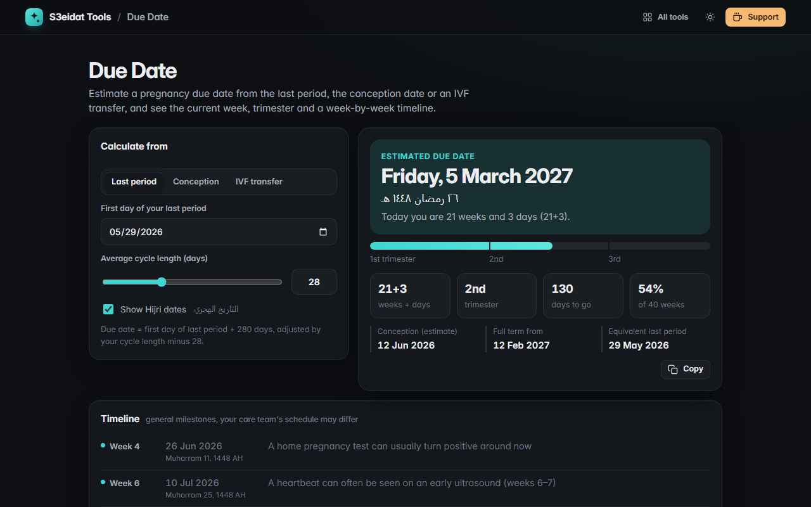

# Due Date

> Pregnancy due date calculator with a week-by-week timeline. Free, private, and it runs entirely in your browser.

### ▶ [Open Due Date](https://s3eidat.github.io/due-date/)



## Features

- Three ways to calculate:
  - **Last period** (Naegele's rule, 280 days) with a **cycle length** adjustment from 20 to 45 days
  - **Conception date** (+266 days)
  - **IVF transfer**, day-3 or day-5 embryo (+263 / +261 days)
- **Estimated due date**, current **weeks + days**, **trimester**, days to go and progress bar
- Estimated conception date and the start of full term
- **Timeline** of general milestones (screening windows, trimesters, full term, late term) with their dates, highlighting the next one
- Optional **Hijri dates** (Umm al-Qura calendar built into your browser)
- Copy a plain-text summary; your inputs are remembered in this browser only

**Not medical advice.** It is a standard estimate; ultrasound dating is more accurate, and your care team's schedule may differ.

## Privacy

Nothing you enter leaves your device. There is no server, no account, no analytics.
The page ships with a strict Content-Security-Policy (`connect-src 'self'`), so the browser
itself blocks any attempt to send data anywhere.

## Run it yourself

It's plain HTML, CSS and JavaScript with no build step:

```bash
git clone https://github.com/s3eidat/due-date
cd due-date
python -m http.server 8000
```

Then open http://localhost:8000.

## Support

If this saved you time, **[buy me a coffee ☕](https://s3eidat.github.io/coffee/)**. It keeps every tool free.

---

Part of **[S3eidat Tools](https://s3eidat.github.io/)**: 100+ free, private tools that run in your browser. MIT licensed.
